<p align="center"></p>

<p align="center">
  <a href="https://github.com/mrzroot/whyenv/releases"></a>
  <a href="LICENSE"></a>
  
  
  <a href="https://github.com/mrzroot/whyenv/commits"></a>
</p>

<p align="center"><a href="https://mrzroot.github.io/whyenv/">Website</a> · <a href="README.fa.md">فارسی</a> · <a href="CHANGELOG.md">Changelog</a> · <a href="CONTRIBUTING.md">Contributing</a></p>

# whyenv

**You changed the variable and nothing changed?** `whyenv NAME` lists every place that can define an environment variable
(your shell, `.env.local`, `.env`, `docker-compose.yml`...) in the order **your framework** reads them (Vite, Next.js,
Create React App, plain dotenv, Docker Compose), marks the one that wins and tells you which of your edits is being ignored,
including the shell startup file or Windows registry entry that probably exports the old value.


English | [فارسی](README.fa.md)

```text
$ whyenv API_URL
whyenv 0.1.1 · API_URL · /tmp/tmpgpidaubx/shop-vite

== Vite (mode=development)
effective value: 'http://old.example.test'   <- from: process environment (your shell)
priority, highest first:
  1. process environment (your shell)             'http://old.example.test'    WINS
       probably set at: ~/.bashrc:3   export API_URL=http://old.example.test
       (whyenv can only see files, not the process that exported it)
  2. .env.development.local                       (no such file)
  3. .env.development                             (no such file)
  4. .env.local:1                                 'http://localhost:3000'      shadowed
  5. .env:2                                       'https://prod.example.test'  shadowed

✗ SHADOWED: edits to .env.local, .env are ignored: the shell already exports API_URL
    why:  vite never overrides a variable that already exists in the process environment; different value(s) in: .env.local (line 1), .env (line 2).
    fix:  remove it from this shell (bash/zsh: `unset API_URL`; PowerShell: `Remove-Item Env:API_URL`; cmd: `set API_URL=`) and restart the dev server; or change the shell value instead. Probably set in: ~/.bashrc:3.

· NOTE: API_URL does not start with VITE_
    why:  vite only exposes VITE_* variables to browser code; reading it there gives undefined (server code and config files can read it)
    fix:  rename to VITE_API_URL if the browser needs it. Never put secrets in VITE_* variables: they end up in the public bundle.

1 confirmed shadowed value(s).
```

(Output of the offline `whyenv --demo`, which builds three broken projects in a temp dir; the full output is in [docs/demo.txt](docs/demo.txt).)

## Why

`.env` handling looks trivial and is not: a variable exported once in `~/.bashrc` (or in Windows *Environment Variables*) silently beats `.env.local`
in Vite, Next.js, CRA and dotenv; `NEXT_PUBLIC_*` and `VITE_*` values are frozen into the build; a Docker container keeps the environment it was
created with; `environment:` beats `env_file:`. People (and AI agents) answer with "restart the server", "delete node_modules" and editing the same file
again. `whyenv` replaces guessing with the actual precedence applied to your actual files.

## Install

Python 3.9+, no dependencies. Tested on Linux; the Windows registry reader (`winreg`) and PowerShell hints are implemented but not tested on
Windows yet.

```sh
pipx install git+https://github.com/mrzroot/whyenv      # PyPI release not published yet
uvx --from git+https://github.com/mrzroot/whyenv whyenv --demo
pip install -e .                                         # from a clone
```

## Usage

```sh
whyenv API_URL                        # in the current project directory (framework auto-detected)
whyenv API_URL -d ../shop             # another directory
whyenv NEXT_PUBLIC_X -f next -m production   # force framework and mode / NODE_ENV
whyenv DB_PASSWORD                    # secret-looking names are shown as ‹hidden, N chars›
whyenv DB_PASSWORD --show-values      # only when you are alone
whyenv API_URL --json                 # machine-readable
whyenv --demo                         # offline demo
```

Exit codes: `0` nothing shadowed, `1` a confirmed shadowed value, `2` the variable is not defined anywhere whyenv looked.

## What it does

- **Precedence per framework**, from each vendor's documentation: Vite (`process > .env.[mode].local > .env.[mode] > .env.local > .env`, only `VITE_*` reaches the browser),
  Next.js / CRA (`process > .env.$NODE_ENV.local > .env.local (not in test) > .env.$NODE_ENV > .env`; `NEXT_PUBLIC_` / `REACT_APP_` inlined at build),
  plain dotenv (process wins unless override), Docker Compose (interpolation: shell > `.env`; container: `environment:` > `env_file:`, later files win).
- **Finds the origin of a shell value** (best effort): `~/.bashrc`, `~/.profile`, `/etc/profile.d`, `.envrc` in the project and its parents; on Windows the user and machine
  registry keys. Reported as "probably set at", because whyenv cannot see the process that actually exported it.
- **Three levels**: `SHADOWED` (confirmed: an edit is ignored; exit 1), `CHECK` (could be the cause), `NOTE` (a trap nearby).
- **Traps around the value**: missing client prefix, build directory older than the `.env` file, an empty value that wins, a similarly named variable,
  BOM, CRLF, spaces around `=`, `$` expansion, inline `#`, duplicate keys, unterminated quotes, a container that was not recreated.
- **Secrets stay hidden** by default (names containing KEY, SECRET, TOKEN, PASS...).

### Use it as a step for agents

Paste [docs/AGENTS.snippet.md](docs/AGENTS.snippet.md) into `AGENTS.md` / `CLAUDE.md` / Cursor rules so an assistant runs `whyenv` instead of editing `.env` in circles.

## Limits (please read)

- It sees **files and the Windows registry**, not other processes. An IDE, a Docker `-e`, a CI runner or a parent shell can set a value that whyenv reports only as "exported by hand, by your IDE or by a parent process".
- It reads the current process environment of *itself*; run it from the same shell you start your dev server from.
- The Compose reader is a **minimal YAML subset** (services, `environment:` as map or list, `env_file:`); anchors, `extends`, profiles and `${VAR:-default}` interpolation inside values are not resolved. Treat a Compose result as "very likely", and verify with `docker compose config`.
- Precedence follows the framework versions' documentation as of October 2026; a framework change would make a rule stale. Please open an issue if you see a mismatch.
- Next.js/CRA rules also depend on `NODE_ENV`, which whyenv does not read from your shell: it assumes `development` unless you pass `-m`.
- It never executes your project, never sends anything over the network and never writes files.

## Development

```sh
pip install -e ".[test]" && pytest     # 25 tests
```

MIT licensed · by [Mohammadreza Zare (mrzroot)](https://github.com/mrzroot) · landing page: https://mrzroot.github.io/whyenv/
